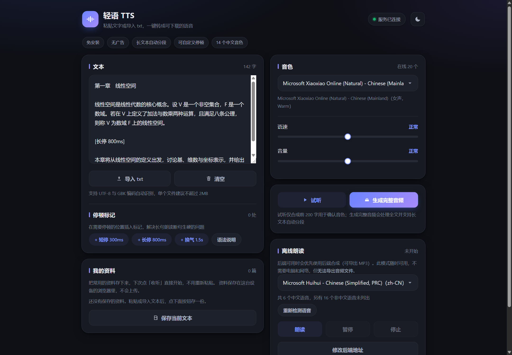

# 轻语 TTS

[](https://github.com/W-Y-Chen/qingyu-tts/actions/workflows/ci.yml)
[](LICENSE)
[](server/requirements.txt)
[](#四运行测试)
[](CONTRIBUTING.md)



> 截图由 `cd server && python app.py` 真实运行后截取。

> 演示视频（90 秒）｜ 发布计划见 [`docs/launch-plan.md`](docs/launch-plan.md)

把**你自己的文本**变成可以戴着耳机听的语音。

它不是"又一个朗读器"，而是为这个具体场景做的：**健身、通勤、做家务的时候，想听自己攒的资料**
（专业书章节、论文、笔记、单词表、讲义），但市面上的听书 App 只能听它们自己的书库，
不让你导入自己的文本。轻语就是这个缺口的最小解：粘贴或导入一篇文章，选个音色，生成音频，
然后戴耳机去健身——锁屏继续放，不耗流量。

免安装、无广告、支持长文本自动分段与自定义停顿标记。

---

## 零、三十秒上手

**最稳的用法（推荐，健身前 1 分钟准备好）：**

1. 电脑上 `cd server && python app.py`；
2. 浏览器打开 `http://localhost:5000`，把资料粘进去（或拖入 txt）；
3. 点「**下载音频**」，MP3 存到手机「下载」目录；
4. 用手机**自带的音乐播放器**打开它——锁屏继续放，不需要电脑、不需要网络。

> 也就是说，**电脑只在"生成"这一步需要开着**。生成完、文件下载到手机之后，
> 后面听多久都跟电脑没关系了。

如果不想下载文件，也可以直接在网页里听：先按播放，再锁屏，声音会继续。
同一份资料会自动记住上次听到的位置。但这种方式的音频链接在服务端只保留 2 小时，
长期收听还是要下载文件。

```
轻语/
├── web/                  网页版前端（手机 / 电脑浏览器通用，随后端同源部署）
│   ├── index.html
│   ├── style.css
│   └── app.js
├── miniprogram/          微信小程序前端（微信原生）
│   ├── app.js / app.json / app.wxss
│   ├── pages/index/      主页：文本、音色、试听、生成、保存
│   ├── pages/library/    音频库：本地音频播放与删除
│   └── utils/api.js      服务端接口封装
├── server/               Flask 后端
│   ├── app.py            应用工厂与启动入口
│   ├── config.py         配置与内置中文音色清单
│   ├── core/
│   │   ├── text_processor.py  归一化 / 停顿标记 / 智能分段
│   │   ├── tts_engine.py      edge-tts 封装 + SSML 注入 + 自动降级
│   │   ├── local_engine.py    本地语音引擎（pyttsx3 / SAPI5，离线兜底）
│   │   ├── audio_merger.py    分段音频合并（MP3 拼接 / WAV 重写）
│   │   └── task_manager.py    异步任务与回收
│   ├── api/routes.py     接口层与参数校验
│   └── tests/            67 项单元测试
├── tools/                构建与排查脚本
│   ├── build_standalone.py     打包成单文件 HTML
│   ├── diagnose_tts.py         合成失败逐层诊断
│   ├── check_offline_speech.js 离线朗读分段逻辑校验
│   └── check_web_utils.js      前端资料 / 下载名 / 进度逻辑校验
└── docs/                 开源发布计划与演示视频脚本
```

> **关于仓库边界**：本仓库是项目「轻语」的开源代码部分。竞赛申报方案书、
> 商业落地材料等内部文档**刻意不放在本仓库内**，内部材料与开源代码分开维护。

---

## 一、后端部署

### 1. 环境准备

```bash
python -m venv .venv
.venv/Scripts/activate          # Windows
pip install -r server/requirements.txt
```

依赖：Flask 3.1.3、flask-cors 6.0.5、edge-tts 7.2.8、python-dotenv。

### 2. 启动服务

```bash
cd server
cp .env.example .env            # 按需修改
python app.py                   # 默认 http://0.0.0.0:5000
```

启动后自检：

```bash
curl http://127.0.0.1:5000/api/health
```

返回示例（字段含义见下）：

```json
{
  "status": "ok",
  "ssml_pause": true,      // 自定义停顿标记是否可用
  "ffmpeg_merge": false,   // 是否有 ffmpeg 做无损合并
  "voices": 14,
  "voice_source": "fallback"   // online=联网音色，fallback=内置清单
}
```

### 3. 关键配置项

| 变量 | 默认值 | 说明 |
| :--- | :--- | :--- |
| `QINGYU_PORT` | 5000 | 监听端口 |
| `QINGYU_MAX_TEXT_CHARS` | 20000 | 单请求文本上限 |
| `QINGYU_SEGMENT_MAX_CHARS` | 400 | 单段合成字数 |
| `QINGYU_PREVIEW_MAX_CHARS` | 200 | 试听截断字数 |
| `QINGYU_MAX_WORKERS` | 3 | 合成并发数 |
| `QINGYU_AUDIO_TTL` | 7200 | 音频文件保留秒数（2 小时，见下） |

### 4. 生产部署要点

- 开发环境用 Flask 自带服务器即可；生产请使用 WSGI 服务器（`waitress-serve --host=0.0.0.0 --port=5000 app:app` 或 gunicorn）。
- **微信小程序生产环境强制 HTTPS**，需在小程序后台配置 `request` 合法域名，并使用 Nginx 反向代理 + SSL 证书。
- 若希望分段音频无损合并（时长元数据准确），请在服务器安装 ffmpeg；缺失时自动退化为二进制拼接。

---

## 一点五、网页版（推荐先用它验证）

网页版由 Flask 同源托管，**不需要额外配置，也不需要 HTTPS**：

```bash
cd server && python app.py
# 电脑浏览器打开   http://localhost:5000
# 手机浏览器打开   http://<电脑局域网 IP>:5000   （需与电脑同一 WiFi）
```

局域网 IP 查询：Windows 执行 `ipconfig`，macOS/Linux 执行 `ifconfig`。若手机打不开，检查 Windows 防火墙是否放行 5000 端口。

网页版相对小程序的三点增强：

1. **可直接下载 MP3 到本地**（电脑磁盘 / 手机「下载」目录），不受微信的文件写入限制；
2. **txt 支持 GBK 自动识别**，浏览器原生解码，不再要求必须是 UTF-8；
3. **支持拖拽导入文件**，停顿标记可插入到光标所在位置。

页面底部可修改后端地址（留空即为同源），便于前后端分离部署。

### 我的资料（反复收听的核心）

既然真实用法是"一份资料听好几次"，资料就不该每次重新粘贴。页面上的
「**我的资料**」把文本存在浏览器 `localStorage` 里（**不上传服务器**），最多 50 篇，每篇记录：

- 资料名、正文、字数；
- 当时用的音色、语速、音量——下次点「**收听**」会一并还原，直接开始合成。

配套的两个细节：

- **下载文件名 = 资料名**。否则存到手机的文件叫 `轻语-20261011-1110.mp3`，
  在播放器里根本认不出是哪份资料。现在会是 `运动生理学 第3章.mp3`
  （自动去掉 Windows / 手机不允许的 `\ / : * ? " < > |` 等字符，并截断到 40 字）。
- **收听进度按资料记忆**。用「文本 + 音色 + 语速」哈希做键，隔着几天再打开同一份资料，
  会自动跳回上次听到的位置（超过 95% 视为听完，下次从头开始）。
  注意试听不会记录进度——试听只有前 200 字，记了就是错的。

### 音频能保留多久

服务端默认把生成的音频保留 **2 小时**（`QINGYU_AUDIO_TTL`）。之前是 30 分钟，
但健身、通勤这种场景会长时间反复收听同一份音频，听到一半链接失效是不能接受的。

超过时间后链接返回 404。因此：**要长期听，就下载文件**。

### 在手机上使用

先确认电脑的局域网 IP（Windows `ipconfig`，通常是 `192.168.x.x` 或手机热点网段 `192.168.43.x`），然后任选一种：

**方式一：传文件到手机，点开即用**（推荐）

```bash
python tools/build_standalone.py --host 192.168.43.4
```

会生成 `web/轻语TTS-移动端.html`（约 49 KB，样式与脚本已内联，零外部依赖）。
把这个文件通过微信/QQ/数据线传到手机，用浏览器或文件管理器打开即可——
**后端地址已预置在文件里，不用手输**。

前提：电脑上 `python app.py` 正在运行，且手机与电脑在同一网络。
若打不开，先检查 Windows 防火墙是否放行 5000 端口。

**方式二：手机浏览器直接访问**

```
http://192.168.43.4:5000/      完整版（样式由服务端分发）
http://192.168.43.4:5000/m     单文件版（短地址）
```

**网络换了怎么办**：重新执行一次构建命令换 IP，或打开页面后点「修改后端地址」手动改。

### 离线朗读（电脑不开也能用）

页面上的「离线朗读（手机本地语音）」卡片**始终可用**，不依赖电脑、后端和网络，
走的是浏览器内置的 Web Speech API。功能包括：

- **长文本分段朗读**：按句末标点、空行、停顿标记切分，逐段串讲，显示「第 n / N 段」；
- **暂停 / 继续 / 停止**；
- **系统音色选择**：自动列出手机已安装的中文语音引擎；
- 语速、音量复用页面上的滑块。

限制（已在界面上明示）：**无法导出音频文件**（浏览器不提供音频流），
自定义停顿标记会被转成自然停顿，音色取决于手机系统是否装有中文语音引擎。
部分安卓浏览器暂停后可能无法恢复，属 Web Speech API 的平台差异。

分段逻辑有独立的测试：

```bash
node tools/check_offline_speech.js
```

该脚本直接从 `web/app.js` 中抽出真实函数运行，不是另写一份副本。

## 一点六、双合成引擎与自动降级

语音合成有两套实现，服务会根据可用性自动选择：

| 引擎 | 依赖 | 输出 | 音质 | 说明 |
| :--- | :--- | :--- | :--- | :--- |
| `edge`（默认） | 微软在线服务，需外网 | MP3 | 好（神经网络音色） | 14 个中文音色，支持 SSML 停顿 |
| `local` | 操作系统自带语音引擎 | WAV | 一般（桌面音色） | 完全离线，断网可用，无需任何外部服务 |

**自动降级（默认开启）**：`edge` 合成失败时会自动切到 `local` 重试，
前端会提示"已使用本地语音引擎"。因此**即使网络访问不了微软服务，依然能出文件**。

手动指定引擎：

```bash
# .env 或环境变量
QINGYU_ENGINE=local      # 只用本地引擎
QINGYU_AUTO_FALLBACK=0   # 关闭自动降级
```

本地引擎依赖 `pyttsx3`（Windows 走 SAPI5，读取系统已装的语音包）：

```bash
pip install pyttsx3
```

Windows 中文系统通常自带「Microsoft Huihui」中文语音。若系统没有中文语音包，
可在「设置 → 时间和语言 → 语音」中安装。

**两种输出的差异**：MP3 体积小（约 6 KB/秒），WAV 体积大（约 44 KB/秒，22050 Hz 16bit 单声道），
但两者都能在手机和电脑上直接播放与下载。

## 二、小程序接入

1. 用微信开发者工具导入 `miniprogram/` 目录（AppID 可先用测试号）。
2. 打开首页，点击底部「服务地址」：
   - 开发调试填 `http://<本机局域网 IP>:5000`（如 `http://192.168.1.10:5000`）；
   - 并在开发者工具「详情 → 本地设置」勾选**不校验合法域名**。
   - 真机预览与生产环境必须使用 HTTPS 域名。
3. 手机与电脑需处于同一局域网；Windows 防火墙需放行 5000 端口。

---

## 三、停顿标记语法

在正文任意位置插入方括号标记即可控制停顿：

| 写法 | 效果 |
| :--- | :--- |
| `[p]` | 停顿 400 毫秒（默认） |
| `[p300]` / `[p300ms]` | 停顿 300 毫秒 |
| `[p1.5s]` | 停顿 1.5 秒 |
| `[停顿]` / `[停顿800]` | 中文写法 |

段落之间的空行会自动插入 500 毫秒停顿。单处停顿上限 5000 毫秒。

---

## 四、运行测试

```bash
cd server
python -m pytest tests -q     # 67 项

# 前端逻辑（直接从 web/app.js 抽真实源码运行，不是副本）
node ../tools/check_offline_speech.js    # 离线朗读分段，7 项
node ../tools/check_web_utils.js         # 资料 / 下载名 / 收听进度，13 项
```

后端 67 项测试覆盖文本归一化、停顿标记解析、分段边界、SSML 构造、装箱不切标签、
参数夹紧、接口校验、任务生命周期、Range 响应与本地引擎合成。
测试不访问网络（合成引擎被替换为内存桩）。

---

## 四点五、故障排查

### 合成失败：`No audio was received`

这是最常见的失败。含义是 **TCP 连得上微软服务，但对方没返回音频数据**。

```bash
cd server
python ../tools/diagnose_tts.py
```

脚本会逐层排查并给出结论：环境与 edge-tts 版本 → 系统时间偏差（鉴权依赖时间戳，
偏差超 5 分钟会失败）→ DNS 解析 → TCP 443 连通性 → 代理设置 → 实际合成调用（含完整异常栈）。

三种常见成因与处置：

| 成因 | 判断依据 | 处置 |
| :--- | :--- | :--- |
| 网络无法访问微软语音服务 | 脚本第 4 步 `speech.platform.bing.com:443` 失败 | 更换网络（如切手机热点）重测；或配置代理 |
| 系统时间偏差过大 | 脚本第 2 步报告偏差 > 300 秒 | 校准系统时间（Windows：设置 → 时间和语言 → 立即同步） |
| 需要代理 | 脚本第 5 步显示已设代理但第 6 步失败 | 检查代理是否对 `speech.platform.bing.com` 生效 |

注：`edge-tts` 复用的是微软 Edge 浏览器的在线合成服务，该域名在部分国内网络环境下
不可达。这不是代码缺陷，是外部依赖的固有限制（方案书 8.4 已列为风险项）。

### 手机端离线朗读：`synthesis-failed` / 读不到语音引擎

| 现象 | 原因 | 处置 |
| :--- | :--- | :--- |
| 提示"检测到微信内置浏览器" | 微信内置浏览器不支持 Web Speech API | 点右上角「···」→「在浏览器打开」 |
| "未检测到系统语音引擎" | 设备未安装中文语音引擎 | 安卓装「Google 文字转语音」或厂商语音包；点「重新检测语音」 |
| `synthesis-failed` | 引擎调用失败 | 同上；页面会弹出可操作的中文提示 |

## 五、已知限制（如实说明）

1. **云端合成依赖外网**。edge-tts 需要访问微软在线合成服务。网络不可达时音色列表回落内置 14 个中文音色；合成失败会自动降级到本地引擎出音频（可用 `QINGYU_AUTO_FALLBACK=0` 关闭）。若两个引擎都不可用才是明确报错。
2. **「我的资料」不跨设备同步**。资料存在浏览器的 `localStorage`，只属于当前这台设备的这个浏览器。清理浏览器数据会丢失，换手机也不带过去。需要同步的话请重新导入 txt。
3. **edge-tts 为非官方接口复用**。
4. **保存到手机需两步（仅小程序端）**。
5. **txt 编码要求 UTF-8（仅小程序端）**。
6. **无 ffmpeg 时时长可能偏差**。
7. **任务状态存于内存**。当前实现未引入外部存储，服务重启后未完成任务会丢失；多实例部署需改用 Redis 等共享存储。
